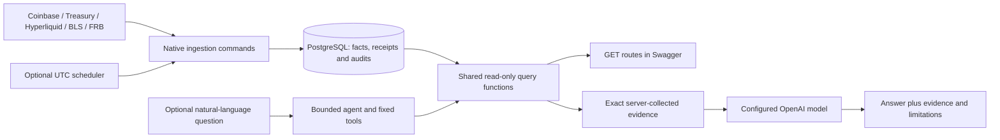

# Local screen-sharing demo

Use a browser with [Swagger UI](http://127.0.0.1:8000/docs) and a terminal in the
repository root. Plan about eight minutes. Keep the demo on localhost while sharing
your screen; no tunnel or hosted deployment is required. The examples below use only
committed application commands and HTTP endpoints, so private development helpers are
not required.



## Prepare before the call

For a fresh installation, follow [README setup](../README.md#start-the-local-environment)
through building, starting PostgreSQL and running explicit migrations. Generate your own
credentials; a clone starts with an empty database. Install the locked host dependencies
only if using host commands. Docker commands do not require the host development runtime.

On an already migrated local installation, start Docker Desktop with Linux containers:

```powershell
docker compose up -d --wait db api
docker compose ps
Invoke-RestMethod 'http://127.0.0.1:8000/health/ready'
```

The browser should load `/docs`, and readiness should return `ready`. Leave `.env` and
credential-bearing output out of your shared window; use `docker compose config --quiet`
when checking configuration.

If the sample history is absent, load these bounded windows before the call. These
commands fetch public provider data and write to your local database; they are separate
from the read-only presentation. BLS quotas apply, so stop on source/quota rejection
rather than repeatedly retrying.

```powershell
docker compose run --rm ingest ingest --start 2024-01-01 --end 2024-01-02
docker compose run --rm ingest ingest-treasury --start 2024-01-01 --end 2024-02-01
docker compose run --rm ingest ingest-funding --start 2024-01-01 --end 2024-02-01
docker compose run --rm ingest ingest-bls --start 2024-01-01 --end 2025-01-01
docker compose run --rm ingest ingest-fed --start 2024-01-01 --end 2025-01-01
```

Check the examples once before presenting. Use historical windows for the main
walkthrough; a latest-stored observation's freshness depends on actual collection.
Run expensive backfills and the isolated full test suite before the call, rather than
waiting for them during the presentation.

## 1. Explain the purpose — one minute

Suggested introduction:

> This project collects crypto, Treasury and macroeconomic observations into PostgreSQL.
> It preserves native units, missing values and collection provenance. A read-only API
> serves deterministic calculations, and an AI agent uses fixed tools backed by those
> same readers to answer questions with inspectable evidence.

Point to the diagram. Providers validate and normalize; stores persist facts and audits;
the scheduler chooses when to run existing jobs. HTTP routes and agent tools share the
reader functions. The agent cannot generate SQL, fetch providers or write data.

## 2. Explore native data — two minutes

In Swagger, select **Try it out**, fill the inputs and **Execute**. Discover the
Coinbase BTC/USD ID through `/v1/markets`; the seeded example below uses ID `1`.

| Endpoint | Inputs | Explain |
| --- | --- | --- |
| `/v1/markets/{market_id}/summary` | market ID; start `2024-01-01`, end `2024-01-02` | USD high/low, traded BTC volume and five-minute coverage |
| `/v1/treasury/curve` | observed_on `2024-01-02` | Source date, nominal yield percentages and the signed 10Y-minus-2Y spread |
| `/v1/hyperliquid/funding/summary` | start `2024-01-01`, end `2024-02-01` | Settled UTC hours; arithmetic funding sum/percent/mean, with no compounded-return claim |
| `/v1/macro/series/CUSR0000SA0/observations` | start `2024-01-01`, end `2024-02-01`, limit `1`; omit cursor | Native seasonally adjusted CPI index, month identity and original content receipt |

All windows are half-open. Focus on a few fields in each response; explain their
meaning rather than reading the full JSON. Prices, yields and other decimals are JSON
strings so their exact numerical representation is preserved. Different source periods
remain separate; presenting them together does not establish alignment or causation.

The same read-only demonstration works from PowerShell:

```powershell
Invoke-RestMethod 'http://127.0.0.1:8000/v1/markets/1/summary?start=2024-01-01&end=2024-01-02' | ConvertTo-Json -Depth 12
Invoke-RestMethod 'http://127.0.0.1:8000/v1/treasury/curve?observed_on=2024-01-02' | ConvertTo-Json -Depth 12
```

## 3. Optional live agent answer — two minutes

The data walkthrough works with the agent disabled and makes no model calls. A live
agent demonstration requires a configured model/key and a separately chosen spending
boundary. The ordinary API has per-question limits, **not an aggregate monetary cap**.
The inspected closeout batch used a separate local spend guard; that completed batch
cannot be reused as authorization for repeated interview calls.

When deliberately running a paid local API demonstration, follow
[agent configuration](../README.md#ask-questions-through-the-agent), configure credentials
in ignored `.env`, enable the agent and recreate only the API. Do not display the key.
The following request makes paid model calls; it does not carry the private acceptance
runner's cumulative spending guard. Keep `AGENT_ENABLED=false` for a data-only demo.

```powershell
$question = @{
    question = 'Report Coinbase Exchange BTC/USD high, low and BTC volume for January 1, 2024 UTC; Treasury 2Y and 10Y yields and their spread on January 2, 2024; and BLS seasonally adjusted CPI CUSR0000SA0 for January 2024. Keep each source, native unit and period separate. Do not calculate inflation or align the datasets.'
} | ConvertTo-Json

$answer = Invoke-RestMethod -Method Post -Uri 'http://127.0.0.1:8000/v1/agent/query' -ContentType 'application/json' -Body $question
$answer.answer
$answer | Select-Object status, limitations, model_requests, tool_calls
$answer.evidence | Select-Object name, arguments
$answer.evidence[0].result | ConvertTo-Json -Depth 12
```

Explain how each numerical claim can be checked against its evidence and the GET route.
The server attaches the actual query results; the model does not manufacture the evidence
array. Inspect prose as well as data: source/date attribution, units, signs, coverage,
rounding and limitations must match. Fixed schemas do not guarantee every prose claim.
Each question has at most three sequential tool calls, four model requests and a
sixty-second execution budget. This question fits three distinct tool inputs.

For a demo without paid calls, show the deterministic agent tests instead, clearly
identifying their model replies as synthetic. After locked host dependency installation:

```powershell
.venv\Scripts\python.exe -m pytest -m "not integration" tests/unit/test_agent.py tests/unit/test_macro_agent.py
```

Those tests use the real SDK's in-memory transport and fake query fixtures. The separate
PostgreSQL integration suite verifies actual reader queries. Synthetic replies demonstrate
the execution contract; they are not a live model answer.

## 4. Show an honest limitation — one minute

On a database with full macro history, request CPI
`[2025-10-01, 2025-11-01)`. At the closeout checkpoint this month is represented by an
explicit source dash: `value: null`, `status: source_missing`, its missing reason and
ordered footnote. This differs from a month absent from local storage. If presenting a
fresh sample-only database, expect absent storage instead; do not imply it collected
that historical source dash. Loading extra history is a separate provider operation.

Explain that the agent's corresponding tool returns a controlled `missing_values`
limitation without substituting an earlier value or zero. For a missing candle or funding
hour, a full-window summary also withholds its metrics. Receipt/materialization times
describe local collection; they do not establish historical publication vintages.

## 5. Show operations and validation — one minute

These inspection commands make no provider or model calls:

```powershell
docker compose run --rm check schedule status --limit 5
.venv\Scripts\python.exe -m market_intelligence schedule preview
```

Explain scheduled slots, actual native audit links, cooldowns and pause/reconciliation
state. A fresh installation has no scheduled attempts until deliberately enabled; an
existing installation shows only its recorded activity. The supervisor starts manually
after Docker restarts. Catch-up coalesces missed opportunities, and history beyond a
refresh window may need manual ingestion. OI can record only actual current receipts.

Finish with the current CI results and one trade-off: native table grains instead of a
universal OHLCV table, immutable locally observed macro corrections, or reader snapshots
that keep values and provenance consistent. The full deterministic suite at Milestone 2
closeout has 1060 tests; inspect the published CI run for the commit you are showing.
The next planned milestone is financial documents and retrieval/RAG.
